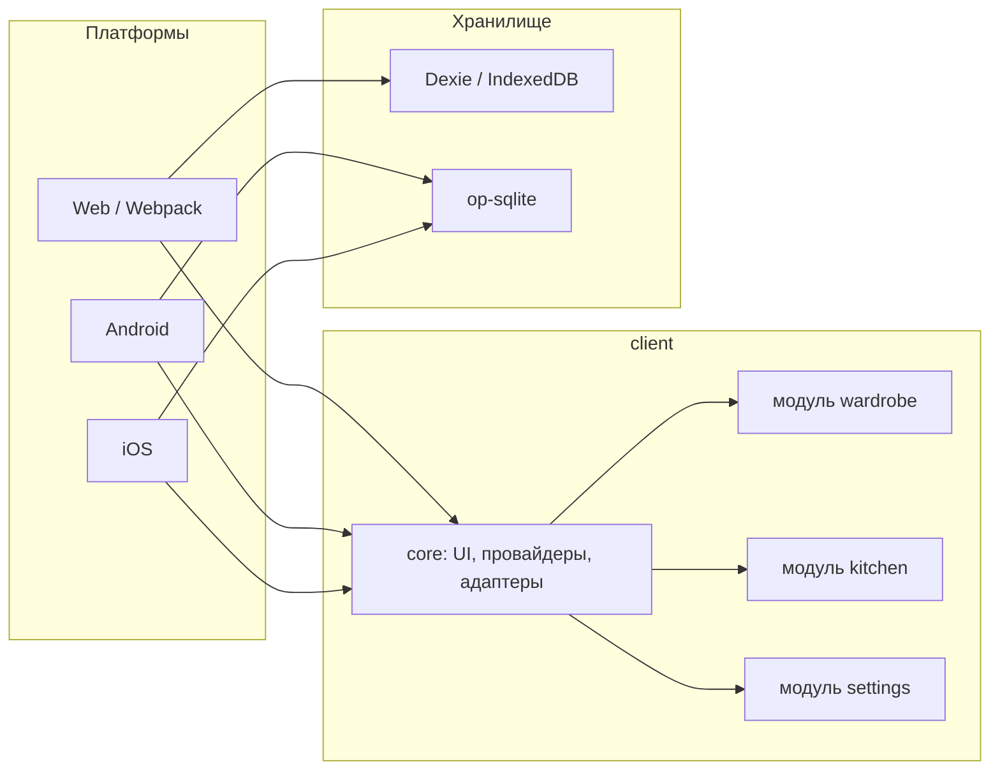

# Life Manager

**Персональный органайзер быта** — не очередной демонстрационный лендинг ради галочки в резюме. Это полноценное, бескомпромиссное offline-first приложение для ежедневного использования, развернутое на базе кастомной кроссплатформенной экосистемы.

Проект решает реальные бытовые задачи (цифровой гардероб и умная кухня), но его главная ценность — **инженерный каркас**. Архитектура спроектирована так, что одна и та же бизнес-логика бесшовно компилируется в **мобильные приложения (iOS/Android)**, полноценный **Web** и даже может работать как **автономное self-hosted веб-приложение в формате "all-in-one HTML"**. Данные живут на устройстве: без аккаунта, без облака, без «просто демо».

[Web](#запуск) · [Android](#запуск) · [iOS](#запуск) · Русский / English · светлая и тёмная тема

<p>
  
  
  
  
  
</p>

---

## Зачем это существует

Проект создавался как манифест независимости данных и гибкости рантайма. Вместо монолитных экранов здесь построена гибкая платформа. Большинство «портфолио» заканчивается героем, стеком и формой обратной связи. **Life** решает скучные, но настоящие задачи:

*   **Абсолютный Local-First.** Никаких обязательных серверов, облаков и внешних API. Данные тотально принадлежат пользователю. Нативно под капотом крутится сверхбыстрая `op-sqlite`, а в браузере — `IndexedDB (Dexie)`.
*   **Универсальный рантайм (вплоть до одного файла).** Архитектура сборки позволяет упаковать всё веб-приложение вместе с базой данных, стилями и логикой в **один единственный автономный `.html` файл**. Его можно скинуть на флешку, запустить без интернета на любом устройстве, и он будет полноценно работать, сохраняя данные локально в браузере.
*   **Платформенные адаптеры вместо костылей.** Навигация (`React Navigation` vs `React Router`), файловая система и жесты изолированы за тонкими адаптерами с расширениями `.web.ts` и `.native.ts`. UI-слой модулей даже не знает, на какой платформе он сейчас исполняется.
*   **Модульный Bootstrap.** Проект разбит на изолированные доменные модули (`wardrobe`, `kitchen`, `settings`). Они могут ничего не знать друг о друге, и подключаться через единую точку входа (bootstrap), регистрируя свои роуты, схемы таблиц БД, переводы и компоненты в ядре системы.
**Данные принадлежат вам.** Бэкап — обычный файл. Нет обязательной регистрации и скрытой синхронизации.


Это рабочий инструмент для одного человека и одновременно витрина инженерного подхода: одна кодовая база, модули, своя дизайн-система, local-first хранилище.

---

## Что умеет приложение

```
┌─────────────────────────────────────────────────────────┐
│  Life                                                   │
│                                                         │
│   Гардероб              Кухня              Настройки    │
│  ┌──────────┐        ┌──────────┐        ┌──────────┐   │
│  │  Лента   │        │  Лента   │        │ Язык     │   │
│  │  Образы  │        │  Блюда   │        │ Тема     │   │
│  │  Одежда  │        │ Продукты │        │ Бэкап    │   │
│  │Категории │        │Категории │        │ Сброс БД │   │
│  └──────────┘        └──────────┘        └──────────┘   │
└─────────────────────────────────────────────────────────┘
```

### Гардероб

Проверить жизнеспособность платформы можно на встроенных модулях, автоматизирующих рутину:


| Экран | Зачем |
| --- | --- |
| **Одежда** | Карточки вещей с фото, сезоном и слотом: голова, слои торса, ноги, обувь и остальное. |
| **Образы** | Комплекты из выбранных вещей — готовый ответ на «что надеть». |
| **Лента** | Очередь образов на ближайшие дни. Порядок меняется перетаскиванием. |
| **Категории** | Справочники сезонов и слотов, которые можно править под себя. |

### Кухня

Домашняя картотека продуктов и блюд, а не чужой каталог рецептов из интернета.

| Экран | Зачем |
| --- | --- |
| **Продукты** | Что есть в доме: название, фото, категория, единица измерения. |
| **Блюда** | Рецепты из своих продуктов, с категорией (завтрак, суп, кето и т.д.). |
| **Лента** | Очередь блюд на готовку. Тот же жест, что и в гардеробе: взял → переставил → приготовил. |
| **Категории** | Меры, категории продуктов и блюд — расширяемый справочник, не зашитый навсегда. |

### Настройки

Приложение должно переживать устройство, а не наоборот.

- **Русский и English** — строки живут в модулях, не размазаны по экранам.
- **Светлая и тёмная темы** — токены дизайн-системы, не набор hex в компонентах.
- **Резервная копия** — экспорт и импорт всей локальной базы.
- **Сброс базы** — чистый старт, если нужно начать заново.

---

## Архитектура



Типичный модуль:

```
client/modules/<name>/
├── screens/        экраны и сценарии
├── components/     списки, селекторы
├── store/          Redux Toolkit
├── models/         схема БД и seed-справочники
├── theme/          стили модуля
├── languages.ts    ru-RU / en-US
├── routes.ts       дерево маршрутов
└── bootstrap.ts    регистрация в приложении
```

---

## Стек

| Слой | Технологии |
| --- | --- |
| UI | React 19, React Native 0.82, react-native-web |
| Навигация | React Navigation (native), React Router (web) |
| Состояние | Redux Toolkit, Formik |
| Данные | Dexie + IndexedDB (web), op-sqlite (mobile) |
| Сборка web | Webpack 5 |
| Сборка mobile | Metro, Gradle, CocoaPods |
| Качество | TypeScript, ESLint, Prettier, Jest |

Node.js **≥ 20**.

---

## Запуск

```sh
npm install
```

### Web

```sh
npm run web:start:dev
```

Прод-сборка:

```sh
npm run web:build:prod
```

### Android

```sh
npm run mobile:android:start:dev
```

### iOS

```sh
bundle install
bundle exec pod install
npm run mobile:ios:start:dev
```

Перед первым запуском native-сборки — [окружение React Native](https://reactnative.dev/docs/set-up-your-environment).

---

## Скрипты

| Команда | Назначение |
| --- | --- |
| `web:start:dev` | Dev-сервер веб-клиента |
| `web:build:prod` | Прод-сборка web |
| `mobile:android:start:dev` | Запуск на Android |
| `mobile:ios:start:dev` | Запуск на iOS |
| `lint` / `lint:fix` | ESLint |
| `format` | Prettier |
| `test` | Jest |

---

## Для кого этот репозиторий

Этот репозиторий — готовый архитектурный паттерн для разработчиков, которые хотят посмотреть, как решать классические боли кроссплатформы:
1. Как шарить 95%+ кода между Web и Mobile без потери производительности.
2. Как элегантно заворачивать нативные зависимости под Web-платформу.
3. Как строить масштабируемые local-first приложения с абсолютной приватностью данных.

<sub>Разработано для себя. Разработка и улучшения продолжаются - нет предела совершенству. Данные никогда не покинут ваше устройство.</sub>
