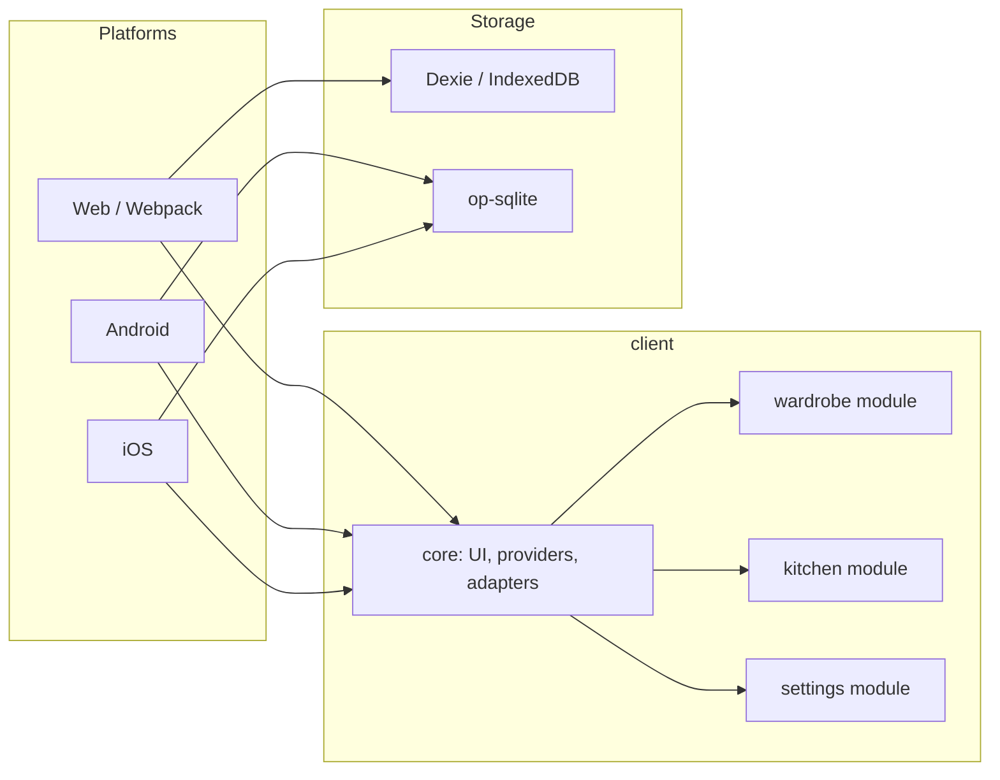

# Life

**A personal household organizer** — not another demo landing page for a résumé checkbox. This is a full, uncompromising offline-first app for daily use, built on a custom cross-platform stack.

The project solves real household tasks (a digital wardrobe and a smart kitchen), but its main value is the **engineering frame**. The architecture is designed so the same business logic compiles into **mobile apps (iOS/Android)**, a full **Web** client, and even an **autonomous self-hosted web app as a single all-in-one HTML file**. Data lives on the device: no account, no cloud, no “just a demo”.

[Web](#run) · [Android](#run) · [iOS](#run) · Русский / English · light and dark theme

<p>
  
  
  
  
  
</p>

---

## Why this exists

The project was built as a manifesto of data independence and runtime flexibility. Instead of monolithic screens, it is a flexible platform. Most “portfolio” apps stop at a hero, a stack, and a contact form. **Life** solves boring but real problems:

*   **Absolute local-first.** No mandatory servers, clouds, or external APIs. Data belongs entirely to the user. Native uses fast `op-sqlite` under the hood; the browser uses `IndexedDB (Dexie)`.
*   **Universal runtime (down to a single file).** The build can pack the entire web app — database, styles, and logic — into **one standalone `.html` file**. Put it on a flash drive, open it offline on any device, and it works fully, keeping data locally in the browser.
*   **Platform adapters instead of hacks.** Navigation (`React Navigation` vs `React Router`), the file system, and gestures are isolated behind thin adapters with `.web.ts` and `.native.ts` extensions. Module UI does not even know which platform it is running on.
*   **Modular bootstrap.** The project is split into isolated domain modules (`wardrobe`, `kitchen`, `settings`). They can know nothing about each other and plug in through a single entry point (bootstrap), registering routes, DB table schemas, translations, and components with the core.

**Your data is yours.** A backup is just a file. No required sign-up and no hidden sync.

This is a working tool for one person and a showcase of the engineering approach: one codebase, modules, a custom design system, local-first storage.

---

## What the app does

```
┌─────────────────────────────────────────────────────────┐
│  Life                                                   │
│                                                         │
│   Wardrobe              Kitchen            Settings     │
│  ┌──────────┐        ┌──────────┐        ┌──────────┐   │
│  │  Feed    │        │  Feed    │        │ Language │   │
│  │  Looks   │        │  Dishes  │        │ Theme    │   │
│  │  Clothes │        │ Products │        │ Backup   │   │
│  │Categories│        │Categories│        │ Reset DB │   │
│  └──────────┘        └──────────┘        └──────────┘   │
└─────────────────────────────────────────────────────────┘
```

### Wardrobe

The built-in modules that automate everyday routines also prove the platform works:

| Screen | Purpose |
| --- | --- |
| **Clothes** | Item cards with photo, season, and slot: head, torso layers, legs, shoes, and the rest. |
| **Looks** | Outfits from selected items — a ready answer to “what should I wear”. |
| **Feed** | A queue of looks for the next days. Order changes by drag and drop. |
| **Categories** | Season and slot dictionaries you can edit to fit your own system. |

### Kitchen

A home catalog of products and dishes, not someone else’s recipe dump from the internet.

| Screen | Purpose |
| --- | --- |
| **Products** | What you have at home: name, photo, category, unit of measure. |
| **Dishes** | Recipes from your own products, with a category (breakfast, soup, keto, and so on). |
| **Feed** | A queue of dishes to cook. Same gesture as in the wardrobe: pick → reorder → cook. |
| **Categories** | Units, product categories, and dish categories — an extensible dictionary, not a hard-coded list. |

### Settings

The app should outlive the device, not the other way around.

- **Russian and English** — strings live in modules, not scattered across screens.
- **Light and dark themes** — design-system tokens, not a pile of hex values in components.
- **Backup** — export and import of the entire local database.
- **Reset database** — a clean start when you need to begin again.

---

## Architecture



A typical module:

```
client/modules/<name>/
├── screens/        screens and flows
├── components/     lists, selectors
├── store/          Redux Toolkit
├── models/         DB schema and seed dictionaries
├── theme/          module styles
├── languages.ts    ru-RU / en-US
├── routes.ts       route tree
└── bootstrap.ts    registration in the app
```

---

## Stack

| Layer | Technologies |
| --- | --- |
| UI | React 19, React Native 0.82, react-native-web |
| Navigation | React Navigation (native), React Router (web) |
| State | Redux Toolkit, Formik |
| Data | Dexie + IndexedDB (web), op-sqlite (mobile) |
| Web build | Webpack 5 |
| Mobile build | Metro, Gradle, CocoaPods |
| Quality | TypeScript, ESLint, Prettier, Jest |

Node.js **≥ 20**.

---

## Run

```sh
npm install
```

### Web

```sh
npm run web:start:dev
```

Production build:

```sh
npm run web:build:prod
```

### Android

```sh
npm run mobile:android:start:dev
```

### iOS

```sh
bundle install
bundle exec pod install
npm run mobile:ios:start:dev
```

Before the first native build, set up the [React Native environment](https://reactnative.dev/docs/set-up-your-environment).

---

## Scripts

| Command | Purpose |
| --- | --- |
| `web:start:dev` | Web client dev server |
| `web:build:prod` | Web production build |
| `mobile:android:start:dev` | Run on Android |
| `mobile:ios:start:dev` | Run on iOS |
| `lint` / `lint:fix` | ESLint |
| `format` | Prettier |
| `test` | Jest |

---

## Who this repository is for

This repository is a ready architectural pattern for developers who want to see how to solve classic cross-platform pain points:
1. How to share 95%+ of the code between Web and Mobile without losing performance.
2. How to wrap native dependencies cleanly for the Web platform.
3. How to build scalable local-first apps with absolute data privacy.

<sub>Built for personal use. Development and improvements continue — there is no ceiling. Data never leaves your device.</sub>
